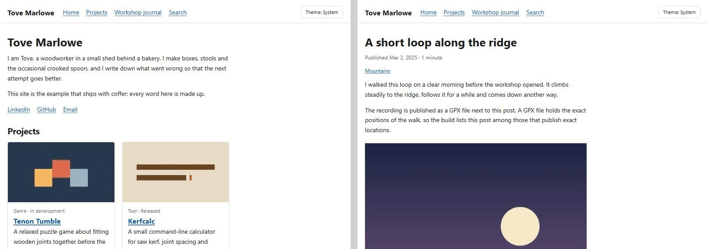

# coffer

coffer is a static site engine for people who make things and write about them. It turns a folder of Markdown posts, project descriptions and photos into plain files that any static host can serve: no server, no database, no JavaScript needed to read a page.

You describe your sites in one `coffer.yaml`, write posts and project pages as Markdown, drop your photos next to them, and run one command. Publishing is whatever your host does with a folder of files, typically a `git push`.



The screenshot shows the home page and a post of the example site that ships with coffer (`example/`), built with the default theme.

## Features

- **Blogs** with posts, drafts that are previewed but never published, posts dated in the future that appear when their time comes, reading time and a table of contents. See [Posts](docs/posts.md) and [Markdown](docs/markdown.md).
- **Tags** that form a tree, built from the tags you use, with a page for every subtree, counts and optional display names. See [Tags](docs/tags.md).
- **Series** with "part n of m", previous and next links and a series page. See [Series](docs/series.md).
- **Projects** as content: a registry of what you make, a page per project, a showcase on the home page, and templates for tools and games (including press kits). See [Projects](docs/projects.md).
- **Project documentation** pulled from the project's own repository: guides rendered in your theme, a generated reference, links from guides to reference pages, and a README section on the project page. See [Project documentation](docs/project-docs.md) and [Documentation sources](docs/docs-sources.md).
- **Images** resized and compressed at build time, with originals that never reach the published site. See [Images](docs/images.md), [Carousels](docs/carousels.md) and [The image viewer](docs/viewer.md).
- **Location and camera metadata policy** (`strip`, `coarse` or `keep`) set per site, per tag subtree, per post and per image. See [Location and camera metadata](docs/location-policy.md).
- **Maps and GPX tracks** drawn from your recordings and photo locations, with no API key. See [Maps and GPX tracks](docs/maps.md).
- **Media originals** kept out of git, in an S3-compatible store, with git hooks that sync them. See [Media originals](docs/media.md).
- **Feeds** in Atom 1.0 with full content, per blog, tag, series and project. See [Feeds](docs/feeds.md).
- **Link previews and search engine metadata**: Open Graph and Twitter tags, generated title cards, canonical addresses, sitemap and `robots.txt`. See [SEO and link previews](docs/seo.md) and [Share summary](docs/sharing.md).
- **Search** for every blog, built at build time and run in the visitor's browser, with word forms. See [Search](docs/search.md).
- **Analytics** that are off by default and, when switched on, add a single cookieless snippet. See [Analytics](docs/analytics.md).
- **Themes** with light and dark colours, a remembered switch, and per-block template overrides. See [Themes and UI strings](docs/themes.md).
- **Home page, 404 page and footer** whose texts, links and license note come from content and configuration. See [The home page, the 404 page and the footer](docs/home.md).
- **Stable addresses**: one canonical URL per page, redirects for old slugs, a 404 page per site. See [URLs, redirects and hosting](docs/urls.md).
- **Mistakes fail the build**: broken links, missing images and unknown project references stop the build with a pointer to the file, and `coffer check` inspects the finished output. See [Links, images and the build report](docs/links.md) and [Checking a finished build](docs/checks.md).
- **Authoring tools**: a live preview with drafts, a new-post command, and scheduled rebuilds. See [Authoring](docs/authoring.md) and [Scheduled rebuilds](docs/scheduling.md).

The [documentation index](docs/README.md) lists every page, including [Configuration](docs/configuration.md) and [Building a site](docs/build.md).

## Requirements

- Node.js 24 or newer.
- Git, for sites that pull documentation from repositories or keep media originals outside git.

coffer is developed and tested on Windows and Linux.

## Quick start

The example site is a made-up woodworker's journal. It builds from a fresh clone with no other setup.

```
git clone <the address of this repository>
cd coffer
npm install
npm run example
```

`npm run example` builds the example site into `example/dist/workshop`. Look at it with the built-in server, which answers like a typical static host does (redirects to the address with a trailing slash, the site's 404 page):

```
npx coffer serve example/dist/workshop
```

Then open http://localhost:8080/. To edit the example and see the result as you save, start the live preview, which includes drafts and scheduled posts and reloads the open page after each rebuild:

```
npx coffer dev --config example/coffer.yaml
```

It prints the address of each site, http://localhost:4000/ for the first one.

To start your own site, copy `example/coffer.yaml` and the `example/content` folder as a starting point and change the names, addresses and texts. [Configuration](docs/configuration.md) describes every key and [Authoring](docs/authoring.md) covers the daily work of writing.

Run `npx coffer help` for the list of commands.

## Tests

```
npm test
```

runs the unit tests, which build the example site, and then the type check.

## Versions

coffer follows [semantic versioning](https://semver.org/). Releases are tagged, and a site should pin a tag rather than follow the main branch. The history is in the [changelog](CHANGELOG.md); see [CONTRIBUTING.md](CONTRIBUTING.md) if you want to help.

## License

coffer is released under the [Apache License 2.0](LICENSE). The [NOTICE](NOTICE) file lists the third-party components that ship with it and their licenses. Themes and the content of a site are not part of the engine, and their licenses are the site's own.

## How to credit

<!-- credits -->
coffer is copyright 2026 Vasily Petrov. If you use it, keep the `LICENSE` and `NOTICE` files with any copy you distribute, mark the files you modified so that readers can tell your version from the original, and do not use the author's name to endorse a derived product. You are not required to say that your site is built with coffer, but a "built with coffer" link to the project's repository is appreciated.
<!-- credits -->
