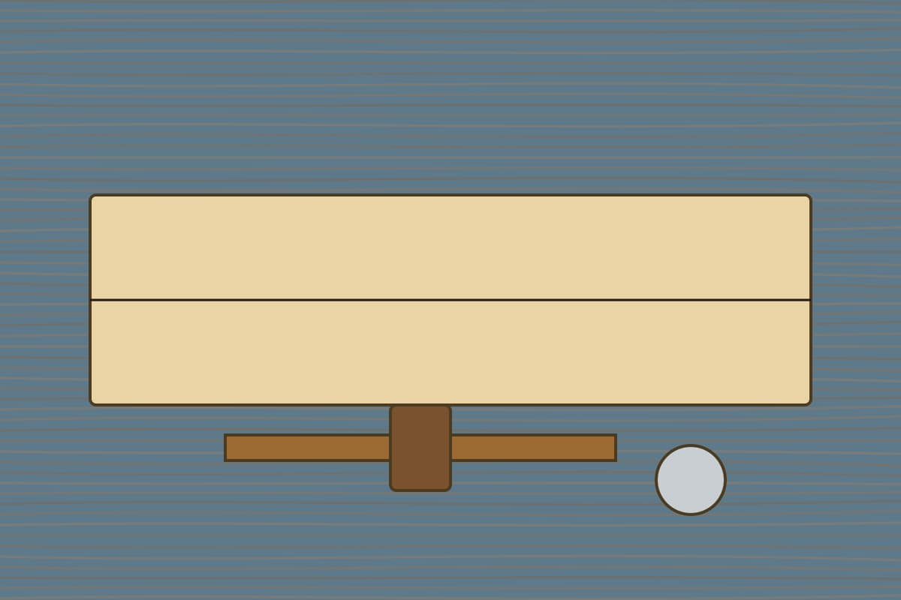
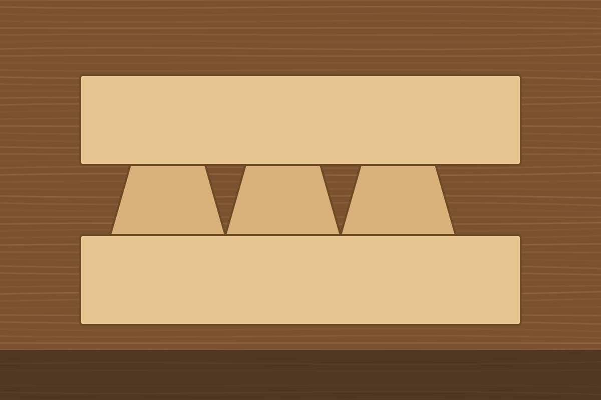

I have glued up plenty of boxes with screws and pocket holes. This month I
wanted a joint that holds a drawer together for fifty years without hardware,
so I cut a dovetail by hand.

## The plan

A dovetail is a row of wedge-shaped pins and tails that lock two boards
together. The wedge shape means the joint cannot be pulled apart, even before
any glue goes in.



I picked a board of soft maple, because it forgives a wandering saw, and set
a few rules for myself:

- mark every line with a knife, never a pencil;
- saw on the waste side of the line;
- stop and look after every cut.

## Marking out

The tails go first. I set a marking gauge to the thickness of the board and
scribed a line around both ends. Then I drew the slope with a bevel gauge set
to about one in seven, which is the classic ratio for softwood and works well
for maple too.

### Spacing the tails

Evenly spaced tails look machine-made. I spaced mine by eye and made the pins
between them narrow, which is what makes a hand-cut joint recognisable.

## Sawing and chopping

Sawing is the easy part once the lines are right. This is the rhythm that
finally worked, written as a small checklist in code form:

```js
const steps = ['saw the tails', 'chop the waste', 'transfer to the pin board'];
for (const step of steps) {
  console.log(`Do: ${step}`);
}
```

Chopping the waste is slower. I worked from both faces of the board toward the
middle, so the edge never blew out.

## Fitting the joint

The first four joints were loose. The fifth was tight on one side. The sixth
slid together with a soft knock and stayed there. I did not glue it; it is
sitting on the bench so I can look at it.



## What I would change

Next time I will practise on cheap pine first, and I will buy a sharper chisel
before I start rather than halfway through.
