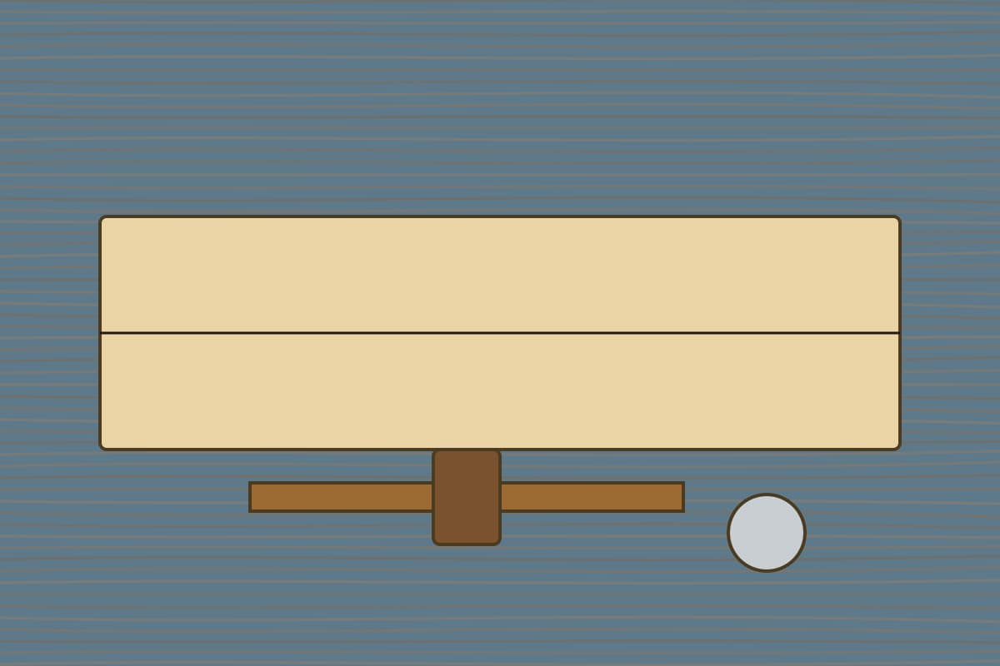
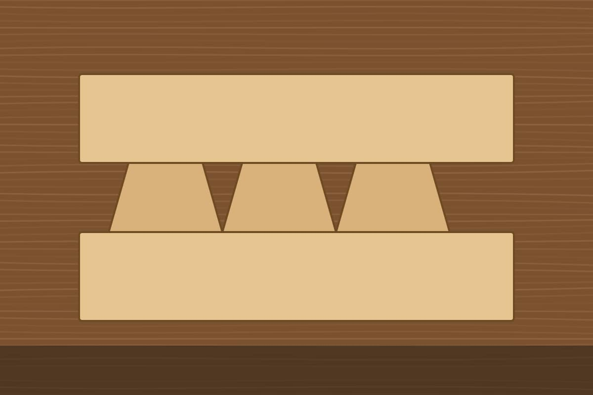

This post shows the `carousel` block. The photos are borrowed from other posts
of this journal; the carousel keeps them in one place, one slide at a time.

:::carousel[Photos from the bench and the hills]

:::

Swipe the photos on a phone, or scroll them with the keyboard or the mouse
wheel. With a script, the buttons under the carousel and the arrow keys do the
same.

A carousel can also be written as a list, which some editors preview better:

:::carousel
- 
- 
:::
