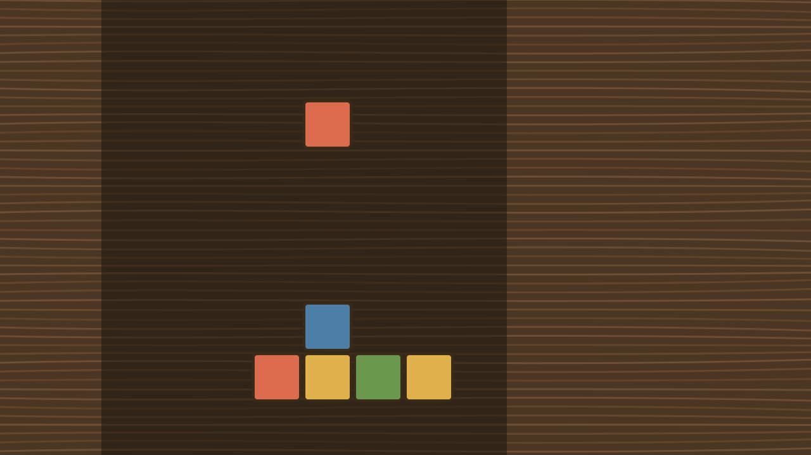
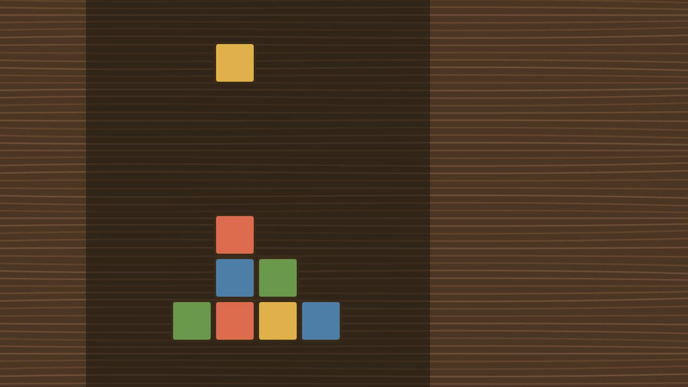

Tenon Tumble is a game for the minutes between jobs: pieces fall, joints have
to line up, and the glue is always a little faster than you.

:::carousel[Screenshots]

:::

It is made by one person in the spare hours of a workshop, so it will be ready
when it is ready. Follow the devlog to see how it goes.
